<h1 align="center">☕ Poranna prasa AI</h1>

<b>Twoja osobista gazeta o sztucznej inteligencji. Co rano, zanim zaparzysz kawę, wiesz, co wydarzyło się w AI, kiedy spałeś.</b>

<a href="https://mchoczay.github.io/ai-prasa/"><b>👉 Otwórz dzisiejsze wydanie</b></a>

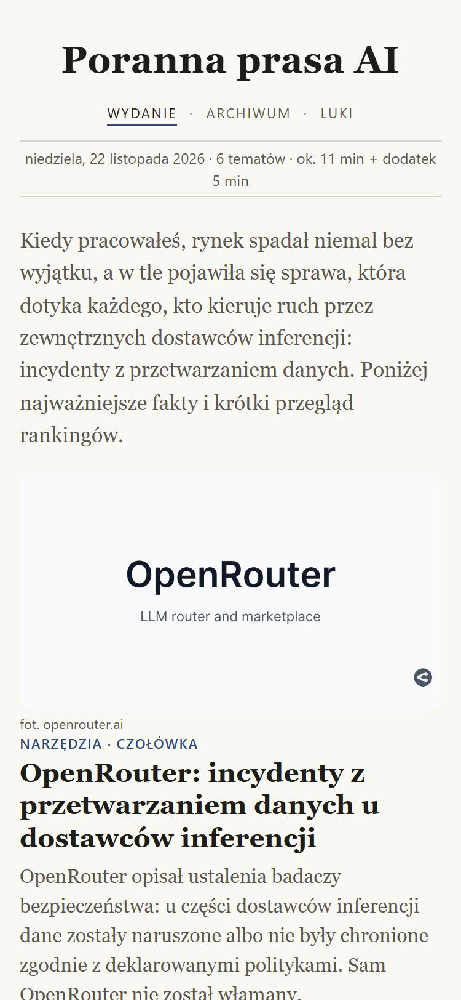

---

## Co to jest?

Świat AI pędzi. Każdego dnia pojawiają się nowe modele, premiery, wyniki giełdowe, plotki i spory, a śledzenie tego wszystkiego to praca na pełen etat.

**Poranna prasa AI robi to za Ciebie.** Co noc przegląda kilkanaście sprawdzonych źródeł, wybiera to, co naprawdę ważne, i pisze z tego krótką gazetę po polsku. Rano dostajesz maila, a całość czytasz w kwadrans, przy kawie.

Bez reklam, bez klikania w nagłówki-pułapki, bez zalewu powiadomień. Jedno wydanie dziennie, spokojnie i do rzeczy.

---

## Twój poranek

<table>
<tr>
<td width="55%">

**Krótko po 5:30** w skrzynce czeka mail z tytułami dnia. Przy każdym widać, czy to informacja **potwierdzona**, **plotka**, czy **opinia**.

Jeden przycisk „Czytaj wydanie” i jesteś w gazecie.

**Około 15 minut** zajmuje przeczytanie całości. Jeśli się spieszysz, wystarczą leady pod tytułami, czyli dwa zdania o każdym temacie.

</td>
<td width="45%">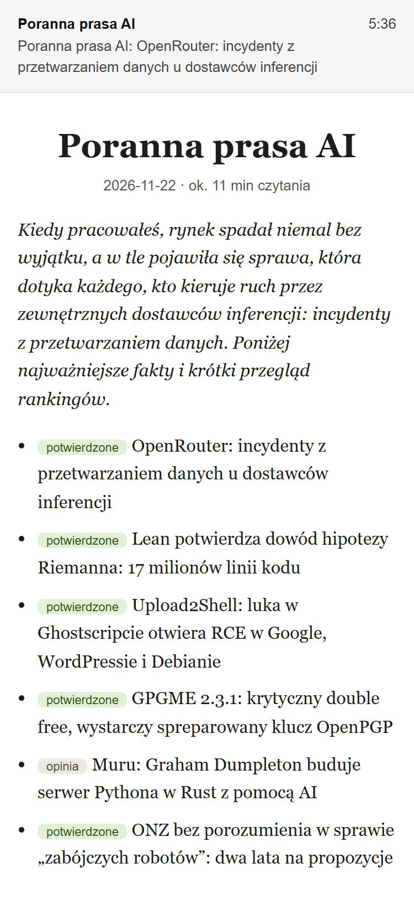</td>
</tr>
</table>

---

## Co znajdziesz w środku

### 📰 Czołówka i tematy dnia

Najważniejsza wiadomość dnia, opisana dokładniej, a pod nią kilka kolejnych tematów: od nowych modeli, przez narzędzia, po prawo i inwestycje. Każdy tekst ma zdjęcie, kategorię i źródła, które możesz sam sprawdzić.

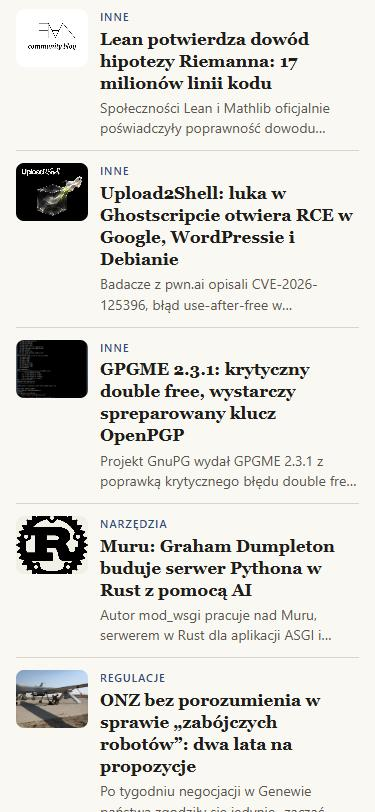

### 📖 Czytnik: strona po stronie

Każdy temat to osobna strona, a między nimi przesuwasz palcem jak w e-booku. Na górze widzisz, ile zostało do końca.

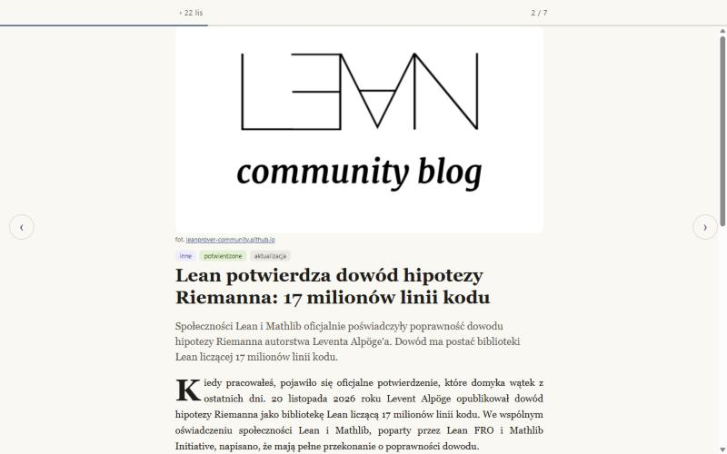

### 💡 Trudne słowo? Stuknij w nie

Pod tekstem są **pojęcia**, które mogą być niejasne: z bezpieczeństwa, finansów, prawa czy sprzętu. Stuknięcie otwiera wyjaśnienie „na chłopski rozum”, z życiowym porównaniem.

Tak samo działają **karty firm**: kim jest dana spółka, co robi i dlaczego ma znaczenie.

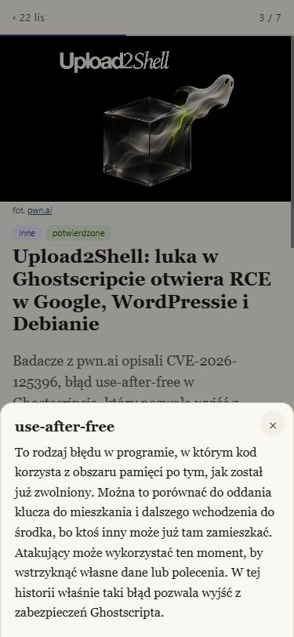
&nbsp;&nbsp;
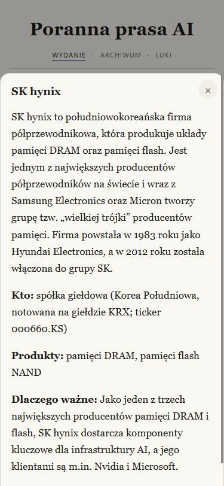

### 📈 Giełda i rankingi modeli

- **Rynek:** jak zachowało się 18 spółek ze świata AI (NVIDIA, Microsoft, Alphabet, Meta, TSMC i inne) w ciągu dnia, tygodnia i miesiąca. Przy dużych ruchach gazeta wyjaśnia „dlaczego?” i uczciwie zaznacza, czy to fakt, hipoteza, czy brak jasnej przyczyny.
- **Rankingi:** które modele AI prowadzą w programowaniu, pisaniu, matematyce, po polsku czy w tworzeniu obrazów. Do tego zestawienia niezależnych testów i to, czym ludzie właśnie się ekscytują.
- **Sprawdzamy:** jeśli kilka dni po newsie o firmie jej kurs mocno się ruszy, gazeta przypomni, o czym wtedy pisała.

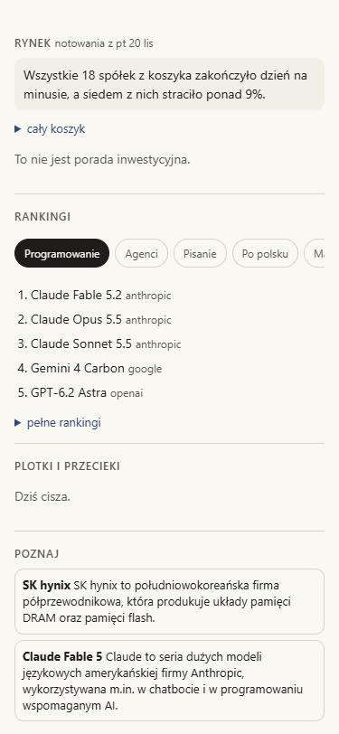
&nbsp;&nbsp;
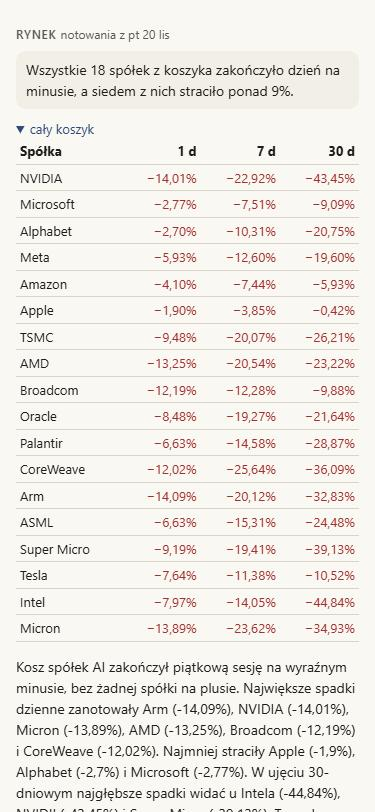

### 🗓️ Tydzień w AI i Miesiąc w AI

W **niedzielę** wydanie ma dodatek: podsumowanie tygodnia w kilku częściach ze śródtytułami, trzy rzeczy warte zapamiętania i mapę „kto prowadzi” w poszczególnych dziedzinach. **Pierwszego dnia miesiąca** przychodzi szersze spojrzenie na cały miesiąc.

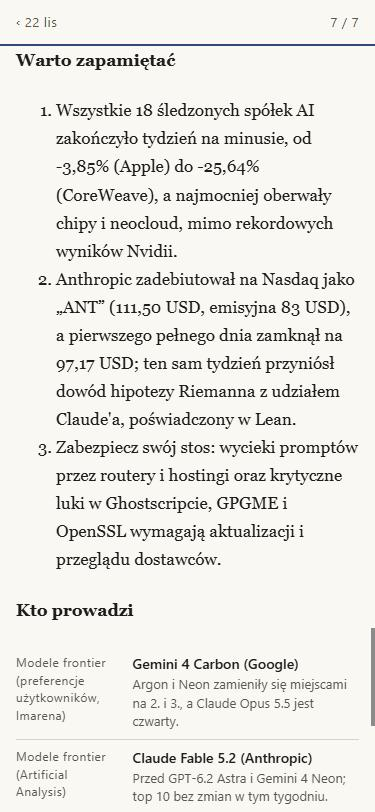

### 🛡️ Luki: dziennik bezpieczeństwa

Gdy gazeta pisze o dziurze w popularnym oprogramowaniu, luka trafia do osobnej zakładki. Co rano dziennik sam sprawdza w publicznych bazach, czy wyszła już poprawka. Widzisz od razu, co jest **załatane**, a co **jeszcze nie**, i jak bardzo jest groźne.

Do tego dochodzi plik z instrukcjami dla asystenta AI, który może z jego pomocą sprawdzić Twoje własne projekty.

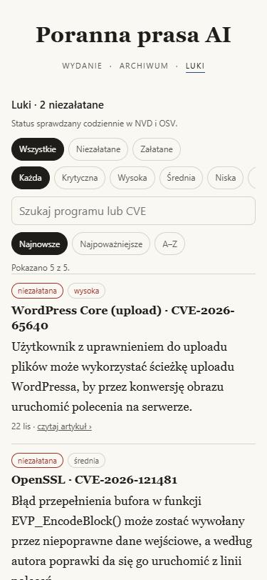

### 🗂️ Archiwum

Wszystkie poprzednie wydania, dzień po dniu, z czasem czytania.

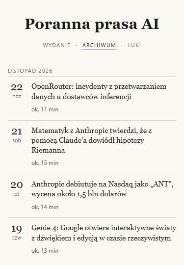

### 🎯 Gazeta, która się uczy

Właściciel może oceniać teksty („więcej takich”, „mniej takich”) i zostawiać krótkie uwagi. Następne wydania biorą je pod uwagę: wybierają tematy bliższe jego zainteresowaniom i piszą prościej tam, gdzie było za trudno.

---

## Skąd są wiadomości?

Wyłącznie z publicznych, sprawdzonych źródeł:

| Co | Skąd |
|---|---|
| **Wiadomości** | blogi OpenAI, Google DeepMind, Google AI, NVIDIA i Hugging Face; działy AI w The Verge, TechCrunch, Ars Technica i MIT Technology Review; CNBC Technology; Hacker News; blog Simona Willisona |
| **Rankingi modeli** | LMArena (głosy użytkowników), Artificial Analysis (niezależne testy), trendy Hugging Face |
| **Giełda** | notowania na zamknięcie sesji (dane opóźnione, nie na żywo) |
| **Luki** | publiczne bazy NVD i OSV |
| **Zdjęcia** | z artykułów źródłowych albo z Wikimedia Commons, zawsze z podpisem autora |

Pod każdym tekstem znajdziesz linki do źródeł, więc w każdej chwili możesz sprawdzić, skąd wzięła się dana informacja.

---

## Jak to powstaje? (w czterech krokach)

1. **🔎 Zbiera.** O 5:30 automat czyta nagłówki z kilkunastu źródeł z ostatniej doby, a do tego notowania i rankingi.
2. **⚖️ Wybiera.** Sztuczna inteligencja odrzuca duplikaty i drobiazgi i wybiera czołówkę oraz kilka najważniejszych tematów dnia.
3. **✍️ Pisze i redaguje.** Jeden model pisze teksty na podstawie artykułów źródłowych, drugi, w roli redaktora, skraca je, wyrzuca powtórzenia i tłumaczy trudne słowa. Automatyczne bezpieczniki pilnują, żeby redaktor nie dopisał żadnej liczby, której nie było w źródle.
4. **📬 Publikuje.** Wydanie trafia na stronę, a do skrzynki leci mail. Całość trwa kilka minut.

---

## Czego się NIE spodziewać

- **❌ Porad inwestycyjnych.** Gazeta opisuje, co się stało na giełdzie, ale nigdy nie mówi, co kupić ani co się wydarzy. Przy tematach o pieniądzach zawsze stoi dopisek „To nie jest porada inwestycyjna”.
- **❌ Wiadomości z ostatniej chwili.** To gazeta poranna: jedno wydanie dziennie, bez powiadomień w ciągu dnia.
- **❌ Plotek podanych jak fakty.** Przecieki trafiają do osobnej rubryki i tylko wtedy, gdy podają je co najmniej dwa wiarygodne źródła albo sprawdzony informator. Zawsze są wyraźnie oznaczone.
- **❌ Zmyślonych liczb.** Kwoty, kursy i miejsca w rankingach pochodzą wyłącznie ze źródeł i danych, nigdy „z pamięci” modelu.
- **⚠️ Nieomylności.** Teksty pisze sztuczna inteligencja i może się pomylić. Dlatego przy każdym są źródła, a przy niepewnych sprawach dopisek, czego jeszcze nie wiadomo.

---

## Pytania i odpowiedzi

**Ile to kosztuje?**
Czytanie jest darmowe. Utrzymanie (praca modeli AI) kosztuje autora około 10 dolarów miesięcznie, a twardy limit budżetu zatrzymuje gazetę, zanim go przekroczy.

**Czy muszę coś instalować?**
Nie. To zwykła strona internetowa, działa w przeglądarce na telefonie i komputerze.

**Dlaczego po polsku?**
Bo większość wiadomości o AI jest po angielsku, a rano nikt nie ma ochoty na tłumaczenie w głowie.

**Czy strona mnie śledzi?**
Nie. Nie ma reklam ani ciasteczek. Jest tylko anonimowy licznik wejść, który mówi autorowi, ile osób zajrzało, a nie kto.

**Co, jeśli któregoś dnia nie będzie wydania?**
Autor dostaje wtedy automatyczny mail z opisem, co poszło nie tak. Wydania z poprzednich dni zostają w archiwum.

---

Dla ciekawskich: działa na n8n (automatyzacja), modelach Claude od Anthropic (pisanie i redakcja) i GitHub Pages (strona). Szczegóły techniczne są w <a href="docs/specs/">docs/specs</a>.

